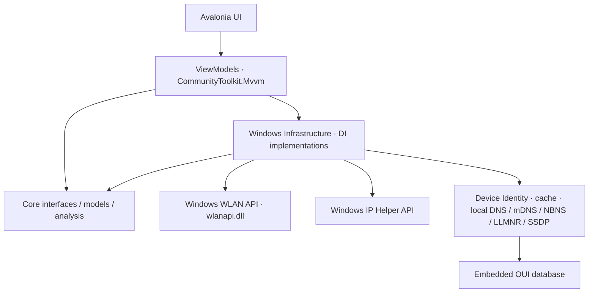

# Wireless Security Analyzer

Текущий релиз: [Version 10](https://github.com/KirillBass/WIFI_Scanner/releases/tag/v10.0.0). Добавлены автоматический поиск HTTP-сайтов и HTML-страниц, работа с несколькими сайтами на разных портах одного узла, проверка сайтов на этом ПК и полный поиск портов выбранного устройства. Исправлено применение пользовательского и полного профилей целевого поиска. Готовый Windows-архив и SHA-256 доступны на странице релиза.

Desktop-приложение на C# / .NET 10 / Avalonia 12.1.3 / ScottPlot.Avalonia 5.1.59 для анализа Wi-Fi среды и собственной локальной IP-сети. Основная платформа - Windows 10/11 x64. Интерфейс на русском языке; браузер и веб-сервер не используются.

Интерфейс содержит семь вкладок сверху, включая «Сетевой аудит». Сводные показатели выводятся обычными строками, панели не имеют декоративных скруглений и больших отступов. Сканирование, мониторинг, фильтры, графики и подробности точек доступа и устройств работают через прежние сервисы. Сохранено оформление Light_Interface; текущая версия приложения: 10.

Version 5 добавляет Device Identity: устройства появляются в таблице до завершения определения имени и производителя, затем обновляются асинхронно. Технические сведения находятся в [отчёте Device Identity](docs/DEVICE_IDENTITY_REPORT.md).

Version 6 расширяет «Эфир»: локальный вендор по BSSID, стандарт 802.11a/b/g/n/ac/ax/be, Wi-Fi 4/5/6/6E/7 и защита Open/WEP/WPA/WPA2/WPA3, включая Personal/Enterprise, WPA2/WPA3 transition и OWE. Данные берутся из Native Wi-Fi PHY и Beacon/Probe Response IE; неподтверждённые характеристики показываются как «Не определено». Шифры, PMF и источник защиты доступны в подсказке и деталях выбранной строки. Описание реализации - в [техническом отчёте «Эфир»](docs/AIR_CAPABILITIES_REPORT.md).

Реализован код Milestones 1–6: подключение к Open/WPA2-Personal с общим контекстом сети, ручное сканирование через Windows Native Wi-Fi API, мониторинг RSSI выбранного BSSID с историей/статистикой, оценочный анализ каналов с визуализацией перекрытия, обнаружение/идентификация устройств и аудит их TCP-портов/служб в текущей локальной сети.

## Milestone 5: подключение к Wi-Fi

Подключение через Windows Native Wi-Fi API и общий `NetworkSessionService` впервые добавлены в Version 7 и сохранены в Version 8. Новый solution и новые NuGet-зависимости не добавлены.

1. На вкладке **Эфир** выберите сеть и нажмите **Подключиться**.
2. Выберите Wi-Fi адаптер. Для Open пароль не нужен; для WPA2-Personal AES/CCMP введите пароль: 8–63 печатных ASCII-символа или raw PSK из 64 hex-символов. SSID может содержать Unicode.
3. Дождитесь результата Windows и IPv4. После получения адреса откроется **Сетевой аудит** с SSID, фактическим BSSID, адаптером, подсетью, шлюзом и защитой.
4. **Обновить устройства** запускает прежнее обнаружение в подсети текущей сессии. **Отключиться** вызывает `WlanDisconnect`, останавливает мониторинг и очищает сессию.

Windows выбирает подходящую точку данного SSID; выбранный BSSID служит контекстом, привязка к конкретной точке не обещается. Профиль временный, пароль не сохраняется приложением и не попадает в журналы. WPA3, transition, WPA/WEP, OWE, Enterprise и скрытые SSID без известного имени пока не поддерживаются для подключения; их отображение в «Эфире» сохранено. Если IPv4 задерживается, приложение показывает отдельное состояние и блокирует аудит до получения адреса. [Технический отчёт Milestone 5](docs/WIFI_CONNECTION_REPORT.md) описывает устройство реализации.

Для WPA2-Personal поддерживается также сочетание `Pairwise: TKIP, CCMP` и `Group: TKIP`: профиль запрашивает AES/CCMP для клиента, групповой TKIP не блокирует кнопку подключения. Сети, у которых в Pairwise отсутствует CCMP, пока не подключаются.

## Сетевой аудит - Milestone 6

Version 8 включает аудит TCP-портов и служб всех обнаруженных устройств текущей сетевой сессии.

1. Подключитесь к Wi-Fi и дождитесь IPv4.
2. На вкладке **Сетевой аудит** нажмите **Обновить устройства**. Используется общий discovery Milestone 4, без отдельного обхода адресов.
3. Выберите профиль: **Быстрый** (по умолчанию, 28 портов), **Стандартный** (1–1024 и основные высокие порты), **Полный** (1–65535, только явный выбор) либо **Пользовательский** (`22,80,443,8000-8010`).
4. Нажмите **Начать аудит сети**. Цели - снимок найденных устройств текущей сессии, шлюз и собственный IPv4. Флажок «Включить этот ПК» исключает/включает собственный адрес.
5. Открытые порты появляются сразу с `Unknown`; HTTP/HTTPS, SSH, FTP, RDP и SMB уточняются по ответу сервера. Фильтры работают по IP/имени/службе/продукту и TCP-порту; подробности доступны по выбору строки.

По умолчанию работают максимум 64 задачи (настраивается до 128), TCP timeout 650 мс. Очередь формируется постепенно, без задачи на каждую пару IP/порт заранее. **Остановить аудит** отменяет подключения и обработчики, сохраняя частичные результаты. При отключении или смене сетевой сессии аудит отменяется, результаты очищаются. При закрытии окна приложение ждёт завершения отмены.

Используется обычный TCP Connect, без прав администратора и внешних web API. Первичное определение HTTP/HTTPS использует `HEAD /`. После определения службы обычный HTTP автоматически дополняется ограниченным поиском стартовой страницы и HTML-ссылок через GET. TLS допускает самоподписанный сертификат только для определения службы - это не подтверждение доверия. SSH ограничен приветствием; FTP использует приветствие и, в целевом режиме, SYST; RDP - negotiation; SMB - NEGOTIATE без входа и перечисления ресурсов.

Результат означает **«доступно с узла, выполняющего аудит»**. Firewall, VLAN, Client Isolation и сон устройства могут скрывать службы. Timeout не означает Closed. Номер порта не доказывает протокол или продукт; скрытые/изменённые заголовки и баннеры ограничивают определение версии. Служба, слушающая только 127.0.0.1, не обязана обнаруживаться по IPv4 интерфейса.

[Технический отчёт Milestone 6](docs/NETWORK_AUDIT_REPORT.md) описывает реализацию и ограничения.

## Требования

- Для разработки: .NET 10 SDK; `global.json` разрешает стабильные feature bands .NET 10.
- Для реального сканирования: Windows 10/11 x64, Wi-Fi адаптер с драйвером, запущенная служба **WLAN AutoConfig** (автонастройка WLAN), включённое радио Wi-Fi.
- Для обнаружения устройств: активный Wi-Fi или Ethernet интерфейс с IPv4; адреса определяются автоматически, обход выполняется постепенно без ограничения размера подсети.
- Windows может требовать разрешение определения местоположения и доступ для классических приложений. При отказе приложение показывает объяснение и кнопку открытия `ms-settings:privacy-location`.
- Права администратора для обычного WLAN scan не требуются. Конкретные ограничения зависят от настроек Windows и драйвера.
- Для запуска self-contained публикации установка .NET Runtime пользователю не нужна. Переносить нужно всю папку публикации вместе с `.exe` и native dependencies.

## Сборка и запуск

Из корня репозитория:

```powershell
dotnet restore WirelessSecurityAnalyzer.sln
dotnet build WirelessSecurityAnalyzer.sln --no-restore
dotnet run --project src/WirelessSecurityAnalyzer.App
```

Версии пакетов зафиксированы в `Directory.Packages.props`; каждый проект содержит `packages.lock.json`. Для воспроизводимой проверки зависимостей используйте `dotnet restore --locked-mode`.

На Linux можно собрать solution. Вызов `wlanapi.dll` на Linux недоступен: приложение показывает сообщение о неподдерживаемой платформе и не подменяет данные демонстрационными.

Публикация для Windows:

```powershell
dotnet publish src/WirelessSecurityAnalyzer.App -c Release -p:PublishProfile=WindowsX64
```

Результат: `publish/win-x64/WirelessSecurityAnalyzer.exe`. Включены .NET Runtime и зависимости Avalonia; single-file publishing и trimming выключены для надёжной загрузки XAML и native libraries.

Рабочий порядок: после изменений кода обновлять локальную Windows-публикацию в `/etc/codex_work/WIFI_Scanner/publish`. Здесь хранить только текущую `win-x64/`, актуальный `WirelessSecurityAnalyzer-win-x64.zip` и его `.sha256`; прежние сборки и дубликаты удалять после успешного создания и проверки новой публикации. GitHub-релиз обновляется отдельным действием по запросу пользователя.

Для запуска скачайте `WirelessSecurityAnalyzer-win-x64.zip` из релиза Version 10, полностью распакуйте и запустите `win-x64/WirelessSecurityAnalyzer.exe`. Для сборки из исходников используйте профиль публикации выше; локальный архив создаётся из папки `publish/win-x64/`. Артефакты сборки исключены из Git и распространяются отдельно от исходников.

## Использование

Откройте раздел **Эфир** и нажмите **Сканировать**. В таблице показаны SSID, BSSID, фактический RSSI в dBm, визуальный индикатор сигнала, канал, диапазон, центральная частота и время обнаружения. Поддерживаются поиск по SSID/BSSID, фильтр 2,4/5/6 ГГц и сортировка по RSSI. Скрытая сеть обозначается отдельно.

Кнопка **Отмена** прекращает ожидание операции. Windows не предоставляет отмену уже отправленного `WlanScan`: системное сканирование может закончиться позже. Последние успешные данные сохраняются при отмене или ошибке; успешное сканирование заменяет набор BSS. Повторное нажатие во время операции не запускает параллельный scan.

В **Обзоре** отображаются количество BSS по диапазонам, обнаруженные адаптеры и состояние мониторинга выбранной сети. **Настройки** содержат доступ к разрешениям Windows и путь локальных журналов.

### Мониторинг RSSI

После сканирования откройте **Сигнал**, выберите точку по комбинации SSID/BSSID/канала/RSSI и нажмите **Начать мониторинг**. Первое сканирование начинается сразу. Затем сервис ждёт выбранные 5, 10, 15, 30 или 60 секунд после завершения предыдущего сканирования. Общий `WifiScanService` координирует существующий `WindowsWifiScanner` и публикует успешные результаты для обеих страниц.

Для выбранного BSSID хранятся последние 300 реальных измерений RSSI. Время sample - момент получения успешного результата, а не метка кэшированной BSS драйвера. Текущий, средний, минимальный, максимальный RSSI, количество и последнее измерение рассчитываются по этому окну. График показывает время и dBm; история остаётся после **Остановить**, **Очистить историю** очищает её без остановки. Выбор точки и интервала блокируется на время мониторинга.

Если BSSID отсутствует, новый sample не создаётся, текущий показатель заменяется на «-», прежняя история сохраняется. После появления измерения продолжаются. Временные Timeout/ScanFailed допускают следующую попытку; отсутствие адаптера, выключенное радио, недоступная WLAN-служба, запрет доступа и неподдерживаемая платформа останавливают loop с понятным сообщением. Разрешения открываются через существующий Windows settings service.

Мониторинг продолжается при смене страницы. Закрытие главного окна отменяет операции и асинхронно дожидается их завершения. История хранится в памяти до закрытия приложения; сохраняется до 32 историй BSSID, более старые неактивные вытесняются. Результаты аппаратного сканирования зависят от Windows, адаптера и драйвера.

### Анализ каналов

Откройте **Каналы** после сканирования или при активном мониторинге. Выберите **2,4**, **5** или **6 ГГц**: график и таблица пересчитываются по последнему общему снимку без нового scan. При первом получении данных выбирается доступный диапазон, предпочтительно 2,4 ГГц. Последующий пользовательский выбор сохраняется. **Обновить анализ** запускает один запрос через тот же `WifiScanService`; независимого polling на странице нет.

Таблица показывает номер канала, центральную частоту, BSS непосредственно на канале, BSS с частотным перекрытием, оценку 0–100%, состояние и рекомендацию. График размещает каждую BSS по её реальной центральной частоте в МГц; высота пика соответствует RSSI в dBm. При наведении видны SSID, BSSID, канал и RSSI. Скрытые сети учитываются, одинаковые SSID с разными BSSID остаются отдельными BSS. Дубликаты BSSID объединяются с выбором сильнейшего RSSI; неизвестные частоты пропускаются с диагностикой. Канал и диапазон нормализуются по частоте.

Текущий scanner не извлекает достоверную ширину BSS. Поэтому явно используется **20 МГц (модель)**. Все вычисления и геометрия контура находятся в Core; View только передаёт готовые точки ScottPlot. Это инженерное приближение для сравнения Wi-Fi BSS, а не спектральная маска IEEE 802.11 или измерение airtime. Другие источники радиопомех такой анализ не обнаруживает.

При параметрах по умолчанию:

```text
SignalWeight = clamp((RSSI + 95) / 60, 0, 1)
OverlapFactor = clamp(1 - abs(BSS_frequency - candidate_frequency) / 20, 0, 1)
RawScore = сумма SignalWeight × OverlapFactor для BSS выбранного диапазона
LoadScorePercent = clamp(RawScore / 3 × 100, 0, 100)
```

Нормализация фиксирована: добавление сильной BSS на другом, не перекрывающемся канале не меняет проценты первого канала. Для центров, разделённых на 20 МГц и более, перекрытие равно нулю, в том числе в 5/6 ГГц. Уровни: менее 20% - «Свободен», 20–40% - «Низкая», 40–60% - «Средняя», 60–80% - «Высокая», от 80% - «Критическая»; верхние границы интервалов не включаются, кроме 100%.

Рекомендуется минимальная оценка. При равенстве выбирается меньшее число влияющих BSS, затем BSS на самом канале, затем меньший номер канала. Если в диапазоне нет валидных BSS или нет кандидатов, рекомендация отсутствует. Учитывается последний RSSI из общего снимка, независимо от активного мониторинга; собственная сеть автоматически не исключается. В `ChannelAnalysisOptions` предусмотрены коэффициенты, пороги, явный `ExcludedBssid` и переопределение кандидатов.

`WifiChannelCatalog` - заменяемый через `IChannelCandidateProvider` источник кандидатов. По умолчанию: 2,4 ГГц - 1–13, 14 добавляется только при обнаружении; 5 ГГц - распространённые 20-МГц каналы 36–64, 100–144 и 149–165 с соответствующим шагом; 6 ГГц - 1, 5, 9, …, 233, специальный канал 2 добавляется только при обнаружении. Настройка каталога может явно разрешать специальные каналы. Набор **не проверен для страны, адаптера и роутера**: это эвристическая рекомендация среди заданных кандидатов; каналы DFS и доступность 6 ГГц зависят от региона/оборудования. Сверяйте выбор с доступными настройками роутера.

Ошибки общего сканирования показываются через прежний `WifiErrorPresenter`, успешные данные сохраняются. Следующий успешный снимок снимает сообщение об ошибке. Остановка мониторинга сохраняет последний анализ, отмена обновления не создаёт ошибку, закрытие окна ожидает завершения и этой операции.

### Поиск узлов с SMB / FTP / Web

На странице **Сетевой аудит** кнопка **Найти целевые серверы** запускает существующий аудит для всех обнаруженных узлов текущей сессии. Если список отсутствует, относится к другой сессии или последние подтверждения старше двух минут, сначала выполняется потоковое обнаружение устройств. Его прогресс отображается на этой же странице; **Остановить аудит** отменяет и подготовку. Используется снимок найденных IP, без ручного выбора отдельного устройства. Этот компьютер включается по существующему флажку, шлюз добавляется автоматически.

В быстром профиле целевой поиск содержит **21, 80, 443, 445, 8000, 8080, 8443/TCP**. Для стандартного, полного и пользовательского профилей кнопка **Найти целевые серверы** использует выбранный профиль. Например, пользовательский список `80,52341` проверит оба порта одного устройства. Поле **Дополнительные TCP-порты** принимает отдельные порты и диапазоны 1-65535, убирает повторы и не меняет профили обычного аудита. На странице выводится точный набор портов текущего запуска. HTTP, HTTPS и FTP определяются по ответу на любом проверенном порту; для целевого поиска существующая SMB negotiation также доступна на дополнительном порту. SMB over NetBIOS и implicit FTPS не реализованы, их наличие из номера порта не выводится.

Режим **Только SMB / FTP / Web** показывает только подтверждённые протоколы. Открытый 445 без SMB negotiation, неопределённый порт и TLS без HTTP не подходят. Неоднозначное FTP-приветствие 220 в целевом поиске дополнительно проверяется командой SYST без входа; подтверждением служит корректный ответ 215. Обычный аудит сохраняет прежний пассивный разбор FTP. Первичное определение HTTP(S) выполняется минимальным HEAD-запросом. Проверка страниц обычного HTTP через GET может также подтвердить HTTP на ранее неопределённом открытом порту.

### HTTP-сайты и HTML-страницы

**Несколько сайтов на одном устройстве.** Результаты различаются по IP, TCP-порту и HTTP-источнику; найденный сайт на 80 не прекращает поиск других проверяемых портов. Если известен дополнительный порт, добавьте его в **Дополнительные TCP-порты** или выберите **Пользовательский** профиль, например `80,52341`, затем нажмите **Найти целевые серверы**. К выбранному профилю также добавляются порты из поля дополнительных портов.

**Если порт неизвестен.** После первого аудита раскройте **Поиск сайтов на всех портах одного устройства**, выберите нужный IP и нажмите **Проверить все TCP-порты этого устройства**. Новый аудит проверит 1-65535 только на выбранном узле; остальные адреса сети в этот запуск не включаются. Список выбора содержит все цели текущего аудита, включая узлы без найденных стандартных служб. Полный профиль можно применить и ко всем найденным устройствам через основной список профилей, если такой объём проверки нужен. Остановка работает в обоих вариантах.

**Сайты на этом ПК.** Флажок **Включить этот ПК** включает и HTTP-проверку собственного сетевого IPv4. Для этого узла автоматически добавляются порты из локальной таблицы слушающих TCP-соединений, доступные на выбранном IP или wildcard-привязке. Поэтому собственный HTTP-сервер на нестандартном порту может быть обнаружен без ручного задания порта. Дополнительные локальные порты не добавляются другим устройствам; при снятом флажке собственный ПК вообще не проверяется. Набор и счётчики портов каждого узла показаны в разделе **По узлам**. Если локальная таблица недоступна, аудит продолжится по выбранному профилю с пояснением.

Сервер должен принимать подключения по проверяемому сетевому IP:порту. Сайты, привязанные только к `localhost`/loopback или IPv6, и неизвестные HTTP Host-имена автоматически не определяются по другому сетевому IPv4. Правила firewall также влияют на доступность порта. На остальных узлах сети неизвестный порт требует полной проверки или явного включения в профиль.

После **Начать обычный аудит** или **Найти целевые серверы** найденные HTTP-службы и неопределённые открытые TCP-порты автоматически проверяются через обычный HTTP. Повторного обхода адресов или поиска портов нет. Поддерживается любой порт, уже проверенный выбранным профилем, включая пользовательские значения вроде `52341`; неизвестный непроверенный порт автоматически не обнаруживается. Подтверждённые HTTPS, FTP, SMB и другие протоколы сохраняют прежнюю обработку.

Выберите строку службы. В карточке появятся URL сайта, HTTP-статус, Content-Type, HTML-title, состояние проверки, кнопка **Открыть сайт** и раскрываемый список **Показать страницы**. Для каждой доступной HTML-страницы отображаются URL, HTTP-код, заголовок и источник. Разные подтверждённые имена на одном IP:порту отображаются как отдельные HTTP-источники. Основные состояния: **Сайт найден**, **HTTP подтверждён**, **Доступ ограничен**, **Стартовая страница не найдена**, **Ошибка соединения**, **Проверка не проводилась**.

Стартовый запрос выполняется через GET к `/`; при необходимости проверяются только `/index.html`, `/index.htm`, `/default.aspx`, `/index.php`. HTTP 401/403 означает ограниченный ресурс, HTTP 404 на стартовых путях сохраняет подтверждение HTTP-службы. Заголовок Server необязателен; IIS, Apache, nginx и другие продукты обрабатываются одинаково, по фактическому ответу. При разрешённом перенаправлении сохраняется конечный URL; максимум 5 переходов.

HTML разбирается AngleSharp без загрузки ресурсов и выполнения JavaScript. Обходятся только ссылки `<a href>` того же HTTP-источника: схема, имя/IP и порт. Фрагменты URL и дубликаты исключаются; ссылки на файлы, вложения, очевидные действия, выход из аккаунта, другие протоколы и внешние ресурсы пропускаются. Внешние ссылки и перенаправления перечисляются в подробностях. Тело HTML используется только в памяти для извлечения title и ссылок.

Ограничения по умолчанию: 30 HTML-страниц на сайт, глубина 2, 2 одновременных запроса на сайт, 4 обрабатываемые TCP-точки одновременно, 5 секунд на запрос вместе с чтением тела, 45 секунд на сайт, 1 МиБ на HTML и 60 HTTP-запросов на источник, включая robots.txt. Тела ответов обычных страниц с не-HTML Content-Type не читаются; ограничение HTML проверяется и по Content-Length, и при потоковом чтении, включая распаковку сжатого ответа. Обрабатываются объявленный charset, BOM и meta charset.

Перед запросами проверяется robots.txt. Используются подходящая группа User-agent, Allow/Disallow, наиболее длинное совпадение, `*` и `$`. При ошибке получения правил обход пропускается с пояснением; редиректы robots.txt на другой источник не выполняются. Пределы robots.txt: 512 КиБ и 512 правил; превышение запрещает обход. Robots.txt не расширяет разрешённую область сети.

Каждое соединение привязано к выбранному интерфейсу и исходному найденному IPv4:порту. Proxy, cookies, автоматические редиректы и системный DNS отключены. Имена берутся из существующей идентификации либо разрешённого перенаправления и дополнительно подтверждаются локальным A-запросом к DNS выбранной подсети или mDNS для `.local`. Имя должно однозначно соответствовать найденному IP; затем оно сохраняется в URL и HTTP Host, а соединение остаётся привязанным к IP. Этот компьютер проверяется по выбранному сетевому IPv4 при включённом флажке **Включить этот ПК**. Сайты на его сетевом IP обрабатываются так же, как сайты других устройств. Перенаправления удалённых сайтов на собственные адреса, loopback и другие IP или порты остаются запрещены. Полный список неизвестных virtual hosts по IP не определяется.

**Остановить аудит** отменяет и HTTP-поиск с сохранением найденных страниц. Смена сетевой сессии очищает старые результаты; запоздалые ответы предыдущего запуска не возвращаются в таблицу. Повторный аудит обновляет результат без накопления одинаковых сайтов. Результаты ограничены найденными узлами, проверенными портами, доступными HTML-ссылками и заданными пределами. Полный обход HTTPS, SPA с JavaScript, авторизация, sitemap, содержимое файлов и скрытые страницы вне ссылок в этой итерации не обрабатываются.

Фильтр вычисляется в памяти: переключение на **Все результаты** возвращает полный результат текущего аудита, включая открытые порты с Unknown и другие протоколы. Переключение не запускает сетевые обращения и не изменяет исходный список на вкладке **Устройства**. Отбор не использует имя, производителя, MAC/OUI или предполагаемую ОС: телефон с подтверждённым FTP включается так же, как NAS с SMB либо роутер с HTTP-интерфейсом.

Подтверждённые строки появляются сразу. В представлении **По узлам** показаны число целевых endpoints, проверенные порты и состояния: ожидание, проверка, совпадение, отсутствие подтверждённых совпадений либо неполная проверка. Таймаут, ошибка и открытая неопределённая служба оставляют неполный результат. Остановка сохраняет найденные совпадения; незавершённые узлы не объявляются узлами без служб. До первого аудита выводится соответствующее пояснение. Все результаты связаны с SessionId и идентификатором запуска; при смене сети старые совпадения очищаются. Для больших подсетей подготовительный discovery может требовать времени; ранее полученный частичный список можно использовать, и его неполнота отмечается на странице.

Короткий профиль означает только поиск подтверждённых служб среди выбранных портов. Он не доказывает отсутствие служб на других портах, наличие публичного сайта или доступность файлов. Перечисление SMB-ресурсов, FTP-вход, подбор паролей и анализ содержимого файлов в этот режим не входят.

### Устройства локальной сети

Откройте **Устройства**. Список интерфейсов показывает активные Wi-Fi/Ethernet IPv4-контексты. Начальный приоритет: наличие шлюза → Wi-Fi → имя/идентификатор интерфейса → числовой IPv4; при нескольких вариантах сеть можно выбрать явно. Loopback, tunnel/PPP, неактивные интерфейсы, непригодные адреса и APIPA 169.254/16 исключаются. Ethernet поддерживается и без шлюза. В карточках отображаются описание интерфейса, IPv4 компьютера, подсеть/маска, шлюз и число известных/Online устройств.

**Сканировать** запускает два этапа в выбранной локальной IPv4-сети. Сначала сразу появляется «Этот ПК», затем проверяются шлюз, кандидаты из Windows Neighbor Table и известные устройства этой сетевой сессии. После этого постепенно проверяются остальные адреса подсети. Повторяющиеся IP пропускаются. Шлюз считается обнаруженным только после подтверждения активности, собственный адрес не проверяется Ping.

Адреса генерируются лениво, без списка на всю подсеть и без отдельной заранее созданной Task для каждого IP. Ограниченная очередь обслуживается максимум 32 рабочими задачами. Подсети /22, /20, /16 и более крупные не блокируются; полный обход большой сети занимает время. Исключаются network/broadcast, loopback, multicast и непригодные адреса. /31 использует оба адреса, /32 содержит один адрес. Произвольный удалённый диапазон не задаётся.

Подтверждённая строка появляется сразу, имя и производитель уточняются асинхронно. Запись в Neighbor Table сама по себе не доказывает Online: после активного обращения сравниваются исходные и свежие данные. Неизменившаяся Reachable или старая Stale-запись не считается новым подтверждением.

Прогресс показывает этап, проверенные адреса, общее количество, процент, найденные устройства, активные проверки и прошедшее время. **Остановить** отменяет очередь и активные операции, ожидает их завершения и сохраняет частичный результат со статистикой. Непроверенные устройства сохраняют прежнее состояние. Повторное сканирование обновляет существующие строки, сохраняя FirstSeen; Offline возможен только после фактических надёжных отрицательных проверок. Смена сетевой сессии отменяет предыдущую работу; одинаковые подсети в разных Wi-Fi сетях не объединяются.

По умолчанию: Ping timeout 500 мс, максимум 32 одновременных probe. Параметры discovery и порог Offline находятся в `DeviceDiscoveryOptions`. Identity-запросы ограничены четырьмя одновременными per-host операциями и четырьмя чтениями UPnP XML; timeout 1 секунда, multicast-окно 2 секунды. Параметры проверяются в `DeviceIdentityOptions`; cache хранит результаты 15 минут. Перед Ping проверяется системный маршрут: адреса, маршрутизируемые через другой интерфейс, например VPN, пропускаются с предупреждением. Соседи фильтруются по выбранному interface index и host-диапазону.

В таблице показаны **IP, роль, имя устройства, производитель, MAC, Ping, Online/Unknown/Offline, Last Seen и First Seen**. MAC добавляется только из валидных системных данных; отсутствие MAC/имени/ответа ICMP отображается как «-». Доступны поиск по IP/MAC/hostname/friendly name/vendor, фильтры состояния и сортировка по числовому IPv4, latency или последнему обнаружению. Строки обновляются на UI thread и сохраняют объекты при повторном сканировании; progress не пересоздаёт таблицу.

**Online** означает ответ ICMP или свежую валидную динамическую запись Neighbor Table после активного обращения: новый адрес, смену MAC, переход в Reachable. Неизменившиеся записи и изменение одного лишь поля ReachabilityTime не доказывают присутствие. **Unknown** означает, что конкретный IP проверен без свежего подтверждения; **Offline** появляется после трёх надёжных отрицательных проверок этого IP в отдельных циклах. Ошибки и пропущенные маршруты не увеличивают счётчик; адреса, до которых отменённый обход ещё не дошёл, сохраняют прежнее состояние. FirstSeen сохраняется, LastSeen обновляется только при подтверждении. В текущей сессии один IP соответствует одной строке. Разные IP с одинаковым MAC не объединяются; MAC используется дополнительно при определении имени и производителя. Совпадение hostname устройства не объединяет.

**Начать мониторинг** запускает первый цикл сразу, затем ждёт выбранные **10/30/60/120 секунд** после завершения предыдущего. Ручной scan и monitoring защищены от одновременного запуска. **Остановить** отменяет текущую операцию/ожидание, сохраняя историю сессии. Мониторинг продолжается при смене вкладки; закрытие окна отменяет операции и ожидает их завершения. При исчезновении интерфейса, смене IPv4/prefix/шлюза мониторинг останавливается с пояснением; обновите список интерфейсов и повторите запуск. Новый контекст сети получает отдельную историю, предыдущий список не смешивается с ним.

Это устройства **локальной IP-сети**, а не association table выбранного Wi-Fi BSSID. Некоторые устройства могут быть недоступны для обнаружения, если беспроводная сеть использует изоляцию клиентов (AP/Client Isolation) или сетевые правила запрещают обмен между узлами. Guest VLAN, сон телефона и фильтрация ICMP также ограничивают обнаружение. MAC может быть приватным/randomized, он не определяет владельца или заводского производителя. Приложение не обращается к внешним MAC lookup API. Проверка TCP-портов и служб выполняется отдельной командой на вкладке «Сетевой аудит». Reverse DNS использует только DNS-серверы выбранного интерфейса, находящиеся в той же подсети. Публичные DNS-серверы и DNS через другой интерфейс пропускаются; RD=0 запрещает запрашивать рекурсивный поиск. История хранится в памяти до закрытия.

### Имя и производитель устройства

После появления строк могут отображаться «Определяется…» и индикатор фоновой идентификации. По окончании - найденное имя или «-». Наведите на имя/производителя: подсказка содержит полный hostname, friendly name, источник каждого вида данных, model/type, достоверность и время обновления. Горизонтальная полоса прокрутки позволяет видеть все колонки.

- **LocalComputer:** имя собственного ПК без сетевого запроса.
- **Reverse DNS:** PTR только к локальному DNS-серверу выбранного интерфейса; прямой запрос через стандартные .NET UDP API позволяет контролировать адрес сервера, timeout и отмену. OS-wide `Dns.GetHostEntryAsync` не применяется, поскольку его DNS destination нельзя ограничить выбранной сетью. Для фактически действующего адаптера шлюз той же подсети добавляется как запасной DNS: это позволяет запросить DHCP/PTR-имя даже при настроенном публичном DNS. Недоступность первого локального DNS не отменяет попытку через следующий.
- **mDNS:** сетевой цикл к `224.0.0.251:5353`, пакетные reverse PTR и DNS-SD service questions. Из опубликованных PTR/A/SRV/TXT сопоставляются только уже найденные IP; исходный `.local` сохраняется. Недостающие сведения запрашиваются последовательно: PTR типа службы → PTR экземпляра → SRV/TXT → A; максимум 3 дополнительных раунда и 64 questions суммарно.
- **Прямой mDNS:** дополнительный unicast PTR к уже найденному IP на UDP 5353 через выбранный интерфейс; помогает, когда multicast не доставляется. Проверяются sender, ID, question, TTL и `.local`; таймаут 1 секунда, права администратора не нужны.
- **SSDP/UPnP:** один M-SEARCH к `239.255.255.250:1900`, затем description XML. LOCATION должен иметь literal IPv4 именно найденного ответившего устройства; hostname URL, внешние адреса, credentials и fragments отвергаются. Чтение ограничено 512 КБ, redirect/proxy/DTD/entities отключены; никаких control actions.
- **NetBIOS:** unicast read-only NBSTAT к UDP 137; выбирается уникальное workstation name, group names пропускаются.
- **LLMNR:** reverse PTR по unicast **TCP 5355** с TTL=1, как требует RFC 4795 для reverse queries. Unicast UDP для LLMNR не применяется.
- **OUI:** локальный embedded snapshot 58 242 MA-L/MA-M/MA-S префиксов, наиболее длинное совпадение. Источник и hash указаны в `Network/Identity/Data/README.md`; в runtime интернет-загрузки нет.

DisplayName: friendly name → hostname → «-». Vendor имеет отдельную колонку и не превращается в выдуманное имя/модель. Hostname: LocalComputer → mDNS → Reverse DNS → NetBIOS → LLMNR. Friendly name и model/type: SSDP → явные mDNS/DNS-SD данные. Vendor: UPnP manufacturer → OUI. Для locally administered MAC local bit `0x02` отключает OUI; без явного UPnP manufacturer показывается «Приватный / случайный MAC».

Cache process-local: найденное имя кэшируется на 15 минут, результат без имени - на 30 секунд; максимум 4096 записей: интерфейс/index + subnet/prefix + gateway + MAC, иначе IP. DHCP-смена IP при том же MAC сохраняет identity. Неуспех последующего запроса не стирает предыдущие значения. Отсутствие имени допускает новую попытку после короткого TTL при следующем scan/monitoring; частично отменённое незавершённое разрешение не кэшируется. Завершённые устройства большого batch сохраняются, чтобы повторные discovery не начинали обработку с первых адресов заново. Устройства, для которых lookup ещё не завершался, обрабатываются раньше повторных попыток. Полного отдельного polling loop для имён нет.

Кнопка **Обновить имена** повторяет идентификацию уже найденных Online-устройств и недавно виденных Unknown-узлов без нового IP-sweep и без ожидания TTL. Она доступна после discovery и завершения предыдущего поиска; мониторинг перед ручным обновлением нужно остановить. Ранее полученные имена/производители сохраняются, даже если повторный запрос не дал ответа. **Остановить** прерывает также запросы имён; интерфейс явно сообщает об этом. Пока идёт поиск, дождитесь исчезновения индикатора. «-» означает, что имя не удалось получить, а не что устройство не найдено.

При смене **Ethernet ↔ Wi-Fi** в одной локальной сети ранее полученное имя может появиться сразу. Для переноса должны совпасть подсеть/префикс, IP и свежий MAC шлюза, а также MAC самого устройства. Одного совпадения IP недостаточно. Сведения собственного ПК и записи без MAC не переносятся. При смене сетевой сессии история присутствия и аудит очищаются; из кэша остаются только недавние имена с подтверждаемым контекстом LAN.

Сохранённое имя не отменяет запросы через новый адаптер. Подсказка показывает интерфейс и время последнего реального получения имени; неудачная попытка через Wi-Fi не обновляет время имени, ранее полученного через Ethernet. Недавно найденный узел `Unknown` можно опросить в течение 2 минут после LastSeen, сохраняя его статус и LastSeen. Для старой записи остаются только прежние сведения; при повторной выдаче IP другому MAC опрашивается только актуальный узел.

Имя не гарантировано: устройство может не публиковать сведения, firewall/изоляция могут блокировать multicast/NBNS/LLMNR; legacy-unicast mDNS поддерживается не всеми устройствами. IPv6 не входит в этот этап. LOCATION с DNS hostname и UPnP HTTPS с недоверенным сертификатом пропускаются. OUI сообщает владельца адресного блока, зачастую изготовителя сетевого чипа, и не доказывает бренд готового устройства. Публичные примеры MAC из ТЗ не подменяют реестр.

## Архитектура

```text
WirelessSecurityAnalyzer.sln
src/
  WirelessSecurityAnalyzer.App/                    # net10.0-windows: Avalonia, MVVM, DI
    Views/, ViewModels/, Controls/, Styles/
  WirelessSecurityAnalyzer.Core/                   # net10.0: модели, интерфейсы, расчёты
    Models/, Interfaces/, Analysis/Channels/, Network/, NetworkAudit/, Common/
  WirelessSecurityAnalyzer.Infrastructure.Windows/ # net10.0-windows: Native Wi-Fi
    NativeWifi/, Wifi/, Network/, NetworkAudit/, Interop/, Services/
docs/
  IMPLEMENTATION_STATUS.md
  DEVICE_IDENTITY_REPORT.md
  AIR_CAPABILITIES_REPORT.md
  WIFI_CONNECTION_REPORT.md
  NETWORK_AUDIT_REPORT.md
```



Core не зависит от Avalonia или P/Invoke. ViewModels получают интерфейсы через конструкторы. WifiScanService хранит общий read-only снимок и сериализует ручные/автоматические запросы; WindowsWifiScanner выполняет native-вызовы вне UI thread и сохраняет свою защиту от параллельных запросов. На каждую операцию создаётся клиент с собственным SafeHandle. Он регистрирует callback **до** `WlanScan`, ожидает `scan_complete` / `scan_fail` через `TaskCompletionSource` и поддерживает тайм-аут 10 секунд на адаптер. После завершения снимается регистрация callback и освобождается handle; память списков освобождается через `WlanFreeMemory` в `finally`.

BSS отслеживаются по BSSID, даже когда SSID совпадает. При нескольких адаптерах одинаковые BSSID объединяются с выбором самого сильного измерения. Если один адаптер не смог выполнить scan, доступны результаты успешно просканированных адаптеров, а частичная ошибка записывается в журнал. Если ни один адаптер не завершил scan, ошибка показывается пользователю.

ObservableCollection существует только в UI. Результаты передаются как `IReadOnlyList` immutable records; обновления коллекций выполняются через UI Dispatcher. «Эфир» и «Устройства» сохраняют объекты строк, «Каналы» отображают read-only результаты Core. Code-behind отвечает за представление, графики/подсказки и запуск команды инициализации при открытии окна. Discovery имеет отдельный модуль и не использует WLAN scan/monitor loop.

Обновление строк трёх таблиц/списков выполняет общий `ViewModelBase.SynchronizeRows`: он сохраняет объекты строк и перемещает их без полного сброса коллекции. `WifiViewModelBase` объединяет состояние ошибок и команду разрешений экранов «Эфир», «Каналы», «Сигнал»; их общий блок ошибки описан шаблоном `WifiErrorTemplate`. `PlotViewBase` управляет оформлением графиков, подписками при открытии/закрытии представления и отложенной перерисовкой. Построение конкретных серий и особенности осей остаются в соответствующих представлениях; расчёты анализа выполняет Core. Связанные короткие модели объединены в файлах `ChannelAnalysisSnapshot.cs`, `SignalStatistics.cs` и `WifiScanSnapshot.cs`; имена типов и их контракты сохранены.

## Данные и ограничения

Вся обработка выполняется локально. Нет cloud API, внешнего MAC lookup, телеметрии приложения, передачи SSID/BSSID/MAC или журналов наружу. Discovery использует ICMP своей подсети. Identity выполняет локальные PTR/mDNS/NBNS/LLMNR/SSDP запросы, читает только проверенное UPnP-описание ответившего найденного устройства и использует встроенную OUI-базу. Системный DNS fallback отсутствует; UPnP redirect, proxy, cookies и внешние XML entities запрещены. NuGet нужен при сборке для получения зависимостей.

Serilog пишет в `%LOCALAPPDATA%/WirelessSecurityAnalyzer/Logs/app-YYYYMMDD.log`; сохраняются 14 последних файлов. Логируются запуск, интерфейсы, начало/конец сканирования, число BSS и технические ошибки. SSID и RSSI каждого измерения не записываются на Information level; выбранный для мониторинга BSSID журналируется при запуске/остановке и исчезновении/восстановлении.

SSID является последовательностью байтов: для отображения применяется UTF-8 с заменой некорректных символов, управляющие символы визуально заменяются. Время обнаружения берётся из `ullHostTimestamp` драйвера; при некорректном timestamp используется время чтения. Драйвер/Windows могут возвращать кэшированный BSS list, поэтому результат не гарантирует ответ каждого AP именно на текущий scan.

Сканер видит BSS, доступные адаптерам и Windows. Подключение к Open/WPA2-Personal выполняется только по команде пользователя; для WPA2 требуется известный пароль. Приложение не определяет пароли и не является RF spectrum analyzer. Стандарт и объявленная защита определяются по Native PHY и поддержанным Information Elements; реальные ширина канала и airtime не измеряются. MAC клиентов конкретной точки доступа из WLAN scan получить нельзя.

## Источники API

- [Avalonia 12.1: TableView](https://avaloniaui.net/blog/release-12-1).
- [Microsoft: WlanScan и уведомления о завершении](https://learn.microsoft.com/en-us/windows/win32/api/wlanapi/nf-wlanapi-wlanscan).
- [Microsoft: WLAN_BSS_ENTRY](https://learn.microsoft.com/en-us/windows/win32/api/wlanapi/ns-wlanapi-wlan_bss_entry).
- [Microsoft: ограничения доступа Wi-Fi и разрешение местоположения](https://learn.microsoft.com/en-us/windows/win32/nativewifi/wi-fi-access-location-changes).
- [Microsoft: GetIpNetTable2 и освобождение таблицы через FreeMibTable](https://learn.microsoft.com/en-us/windows/win32/api/netioapi/nf-netioapi-getipnettable2).
- [Microsoft: MIB_IPNET_ROW2 и состояния соседей](https://learn.microsoft.com/en-us/windows/win32/api/netioapi/ns-netioapi-mib_ipnet_row2).
- [Microsoft: асинхронный Ping с CancellationToken](https://learn.microsoft.com/en-us/dotnet/api/system.net.networkinformation.ping.sendpingasync?view=net-10.0).

- [RFC 6762: mDNS, one-shot queries и legacy-unicast ответы](https://www.rfc-editor.org/rfc/rfc6762).
- [RFC 6763: DNS-SD PTR/SRV/TXT](https://www.rfc-editor.org/rfc/rfc6763).
- [RFC 4795: LLMNR, reverse queries раздел 2.4](https://www.rfc-editor.org/rfc/rfc4795).
- [RFC 1002: NetBIOS node status](https://www.rfc-editor.org/rfc/rfc1002).
- [UPnP Device Architecture 2.0](https://upnp.org/specs/arch/UPnP-arch-DeviceArchitecture-v2.0.pdf).
